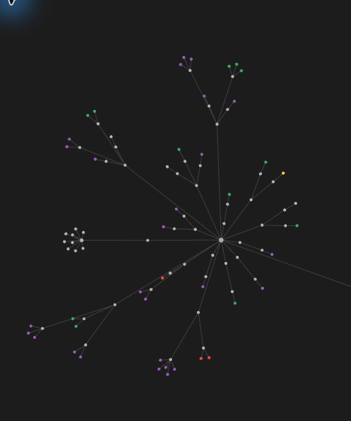

# Общее правило построения графа проекта

## 1. Принадлежность и уровни

Образец — нынешние «Эксперименты»: раздел, направление, группа и отдельная запись. Внешние направления и группы исходов сохраняются. По уточнению автора внутри больших групп исходов должны идти темы, задачи и способы решения; десятки опытов непосредственно под одним исходом недопустимы.

В других ветвях применяется та же форма. Группа объединяет записи по конкретной теме, вопросу, способу решения либо явно названному состоянию. Если несколько разных тем собраны одним большим лучом, сначала выделяются содержательные подгруппы. Деление по алфавиту, номеру страницы или случайному размеру пакета не заменяет смысловую классификацию.

У узла ровно один структурный родитель. Связь означает принадлежность, а не доказанное научное следование. Первичные отчёты, статьи и соседние разделы доступны переходами без структурного ребра.

## 1.1. Утверждённый вид по образцу «Экспериментов»

Источник образца — скриншот автора от 08.11.2026. Каждая видимая группа строится как дерево: один центр, несколько лучей к серым узлам разделов, затем серые узлы подгрупп, затем цветные конечные записи. Если внутри подгруппы несколько разных вопросов или способов решения, между ней и записями добавляется следующий смысловой уровень.

Недопустим вид «один центр и десятки конечных точек напрямую», если эти точки относятся к разным вопросам и подходам. Нельзя ограничиться формальным номером в имени: промежуточные уровни должны существовать как отдельные заметки и реальные связи.

В «Экспериментах» внешняя структура: центр → направление → исход. В больших группах исходов дальше идут тема → задача → подход → конкретный опыт. Например: «Эксперименты → FlyVis → Завершён с отрицательным результатом → Сохранение личности → Восстановление потерянного объекта → Маски объекта → Маска по запросу выдачи».

Номер указывается в имени и свойствах. У дочерней записи он продолжает номер родителя ровно одним порядковым компонентом. При введении тематических подгрупп дочерние номера пересчитываются от единицы. В имени после номера описывается содержание; дата, идентификатор запуска или слово «прочее» не заменяют объяснение.

Серый узел означает группу без собственного научного результата. Конечные проверки красные до выполнения, жёлтые в работе, зелёные при подтверждённом положительном исходе, фиолетовые при завершении без положительного исхода. Неопределённость подписывается словами. Инфраструктура нейтральна, если у неё нет научного исхода.

Внешние структурные связи между самостоятельными деревьями не добавляются. Переходы к источникам доступны без рёбер. Согласованное исключение — справочник терминов с двумя уровнями. Журнал группируется по периодам, названия его записей остаются содержательными.

Расположение кружков на экране рассчитывает Obsidian; образец задаёт структуру ветвления и цвета, а не фиксированные координаты.

## 2. Номер и название

Номер составляется из номера родителя и одного порядкового компонента. Число компонентов равно уровню. Каждый номер уникален. Номер, родитель и уровень проверяются независимо от подписи.

Автор подтвердил сохранение цифр по образцу «Экспериментов». Номер отделяется от содержательного русского названия. Дата и код опыта хранятся в свойствах или тексте; они не заменяют название.

При переносе в другую группу номер изменяется в соответствии с новым родителем. Прежний файл сохраняется с архивной меткой и скрывается из обзора.

## 3. Цвет

Красный — ожидает проверки; жёлтый — выполняется или решено частично; зелёный — положительный итог; фиолетовый — завершённая научная проверка без подтверждённого положительного исхода. Неопределённый исход подписывается именно как неопределённый. Инфраструктура и группы без научного исхода нейтральны.

Цвет не меняет исходную карточку, критерий или вывод. Частный подтверждённый эффект в «Лучших результатах» может быть зелёным при общем неопределённом исходе опыта, если это явно объяснено.

## 4. Исключения и источники

Термины сохраняют два уровня по отдельному поручению автора. Журнал группируется по периодам; названия дней описывают их содержание, дата остаётся в свойствах. DRB полностью исключён из видимого обзора, его код, карточки и архивные файлы сохраняются.

Граф строится из каталога, реестров, первичного плана и сохранённых заметок. Восстановленные Д1–Д7 — архивные постановки, не очередь запуска. Ни одна навигационная правка не разрешает научный опыт.

## 5. Приёмка

Проверить на копии полноту разрешённых записей, уникальность номеров и путей, соответствие номера реальному родителю и уровня числу компонентов. Проверить отсутствие случайных рёбер между разделами, пустых конечных заметок, видимого DRB и даты вместо названия. Убедиться в сохранности исходников и одинаковом результате повторной сборки.

После массовой записи обновить индекс открытого Obsidian и сверить фактически распознанные связи. Наличие ссылки на диске само по себе не подтверждает, что приложение её уже прочитало.
