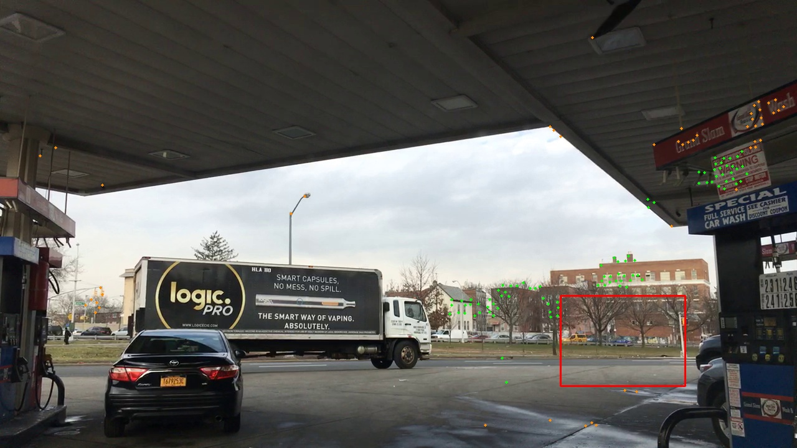
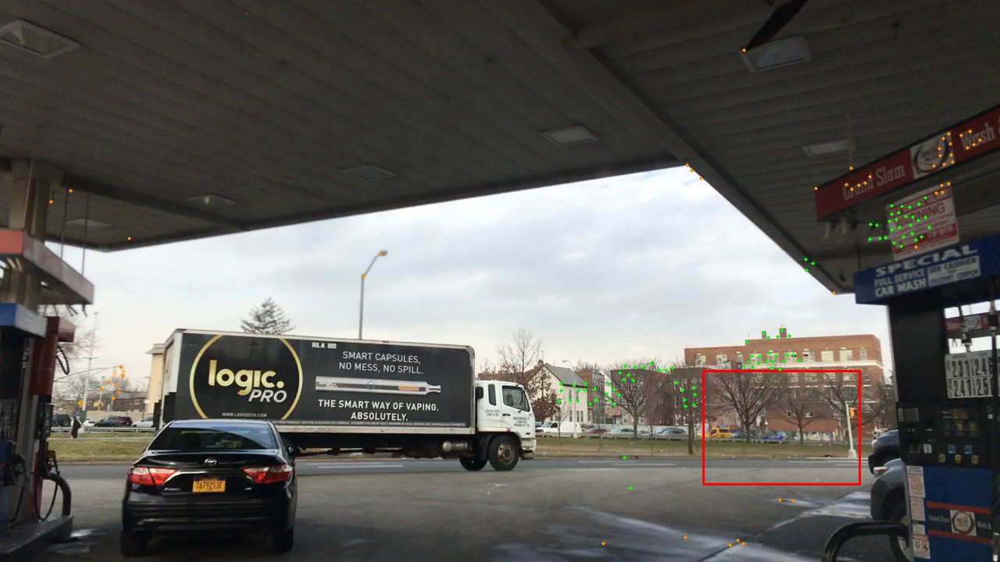

# Движение фона и конкуренция номеров при первом разрыве

1. Результат

Исходная матрица539 размером22×14 и её назначения воспроизведены точно. Для перехода537→538 использованы140 точек оценки и142 контрольные; медиана ошибки0,510025 пикселя,90-й процентиль4,953860. Для538→539 —135 и141 точка; медиана1,314910,90-й процентиль5,222362 при заранее заданном пределе5. Условие точности не пройдено. Оценённое смещение в положении232:−7,736196 пикселя по горизонтали и+10,548721 по вертикали; оно не принято как точное движение объекта или камеры. Источники research_camera_motion_probe_20261112/result.json, transforms; research_camera_motion_probe_20261112/protocol.json. Без подстановки минимальная стоимость232 равна0,941220. Прямая поправка только232 даёт0,790343 и назначает54471 при прежнем пороге0,8. Та же поправка всех строк отдаёт54471 номеру474: стоимость0,787723 ниже0,790343. Остаточная поправка с учётом предыдущего перехода отдаёт54471 номеру232:0,785617 против0,787948 у474. Различие координат поправленной рамки232 между этими вариантами не превышает0,252801 пикселя. Обратная поправка не возвращает232. Независимо воспроизведены2156 стоимостей с нулевой ошибкой. Источники research_camera_motion_probe_20261112/result.json, arms; research_camera_motion_probe_20261112/audit.json, competition.

2. Что это объясняет

Подстановка только строки232 устраняет её геометрический отказ, но не доказывает сохранение её номера при общем изменении координат. Конкурирующая474 перехватывает рамку в одном заранее заданном варианте. Выбор между232 и474 меняется при малом изменении способа компенсации; точность оценки фона недостаточна для уверенного выбора. Следовательно, утверждение «движение камеры является установленной достаточной причиной потери232, компенсация её исправляет» этой проверкой не подтверждено. Установлены чувствительность назначения к геометрии и роль уже существующей конкурирующей ветви. Ядро FlyVis здесь не участвовало: событие находится до позднего сравнения его карт.

3. Достоверность движения

Из оценки исключены все сохранённые детекции с уверенностью не ниже0,1 с полем20 пикселей и область900,475–1100,620 вокруг исследуемого объекта. Точки разделены пространственной сеткой на используемые для оценки и контрольные. Соответствия найдены методомLucas–Kanade — отслеживанием локальных изображений; проверено обратное перемещение. Преобразование подобия — общий поворот, масштаб и сдвиг — оценено устойчивым методом с исключением выбросов. В контрольных точках переход538→539 не прошёл зарегистрированное условие. Эти параметры служат диагностике и не меняют рабочий трекер.

На изображениях контрольные точки лежат на зданиях, навесе и ближних поверхностях. Неодинаковые остаточные смещения совместимы с ограничениями единого преобразования для сцены разной глубины. Это объяснение остаётся гипотезой: физическая причина остатков отдельно не измерена.

4. Техническая проверка

Первый диагностический расчёт остановился до подстановок: исходная матрица отличалась максимум на1,072884e−6. Причина — пропущенное преобразование детекции из углов рамки в центр/размер и обратно вfloat32, то есть32-битных числах. Восстановлен фактический порядок преобразований; после этого все308 исходных стоимостей совпали точно. Исходныйprobe.py, исправленныйprobe_v2.py иrecovery.json сохранены. Критерии и параметры оценки движения не менялись. Это ошибка диагностического восстановителя, а не обнаруженная ошибка архивного трекера.

Все семь матриц проверены независимым скалярным пересчётом геометрии. Стоимости308 связей в каждой матрице совпали. Оптимальная сумма назначения проверена независимым решателем с явной стоимостью неназначенных строк и столбцов. Контрольные суммы исходных данных сохранены до расчёта и подтверждены после него.

5. Ограничения и решение

Это одна сохранённая матрица и два перехода кадров, не новый полный трекер. Эталонной личности на539 нет. Подавление дублей не применялось, карты и веса не пересчитывались, рабочие пороги не менялись. Ошибка модели движения фона не отделена на параллакс, несовершенство соответствий и другие причины. Оба способа компенсации заранее заданы, но условие готовности не пройдено; их назначения остаются условными диагностическими результатами. Нельзя объявлять доказанными причину всех отказов, улучшение FlyVis, сохранение личности или приростHOTA.

Не ослаблять предел ошибки5 пикселей после результата и не внедрять компенсацию по этому случаю. Сохранить отрицательный контроль готовности. Не возвращаться к подбору порогов по232/474. Для доказательства физической причины нужны более точные независимые соответствия неподвижного окружения в глубине объекта и проверка устойчивости назначения к их погрешности. Для основной проблемыFlyVis отдельно продолжать разбор неверного порядка своих и чужих пар: текущая проверка локализует ошибку до вызова модуля и не объясняет свойства его активности.

Литературное основание: Aharon, Orfaig, Bobrovsky,2022, BoT-SORT: Robust Associations Multi-Pedestrian Tracking, https://arxiv.org/abs/2206.14651. В работе применяется компенсация движения камеры; она обосновывает проверяемый механизм, но не доказывает причину нашего случая.

Проверка движения → выбор232 в отдельных условных матрицах вместо отсутствия назначения → процент улучшения качества не вычисляется → доля потолкаHOTA не измерена.
