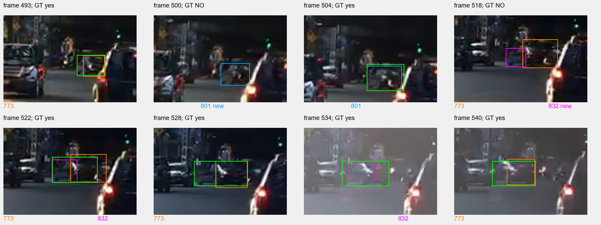
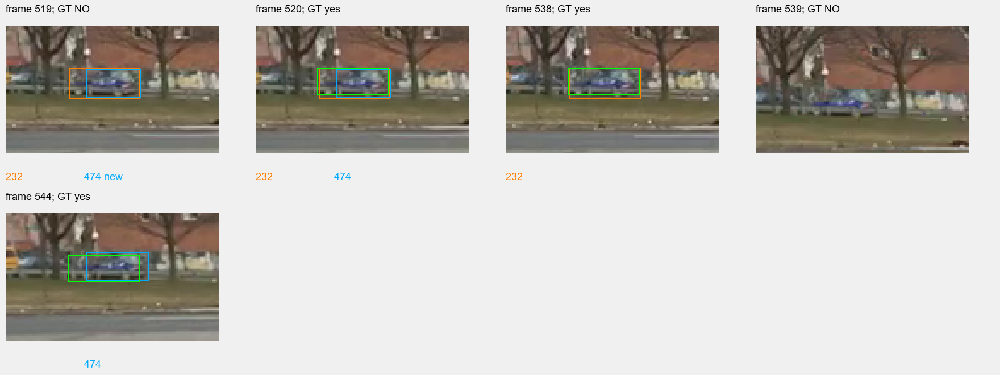

# Почему появились конкурирующие номера

1. Восстановление и доказательства

Восстановлены пять отдельных состояний при неизменных архивных назначениях:158 сохранённых средних и ковариаций совпали точно,393 публичные рамки совпали вfloat32,1957 сохранённых стоимостей158 строк совпали точно. Независимая покоординатная реализация проверила560 шагов; максимальное расхождение среднего7,11e-15 и ковариации5,68e-13. На519 старая ветвь232 получила детекцию52351 стоимостью0,464303; другая детекция52356 была также допустима для232 со стоимостью0,733357, но стала новой474 после назначения другой рамки. На500 детекция29726 получила801: стоимость её связи с потерянным773 равна0,898612 при допуске0,8. FlyVis не вызван: в окне один кандидат вместо требуемых двух. Условный просмотр следующего фильтра также дал отказ по вертикали: низ детекции418,503540 ниже максимально разрешённого низа полной рамки417,544397 на0,959143 пикселя. Разрыв5 кадров и54 ячейки допустимы. На518 связь будущей832 с773 имеет стоимость0,984428, с801 —1,0;773 в тот же кадр получил другую детекцию со стоимостью0,578601. Активная773 исключена из визуального восстановления по состоянию, а у потерянной801 нет кандидатов в окне. Источники research_id_state_reconstruction_20261112/reconstruction_v2.json, audit.json, cost_audit.json, eligibility.json, downstream.json, vertical_bound.json.

2. Объяснение механизмов

Подтверждены разные механизмы рождения номеров. 474 возникла при двух допустимых детекциях рядом с уже сопровождаемой232; ослабление допуска пары не убирает требование взаимно-однозначного назначения и само по себе не предотвращает новую ветвь. 801 возникла после недопустимой геометрической стоимости; дополнительная проверка FlyVis недоступна из-за числа кандидатов, а снятие только этого ограничения всё равно оставляет вертикальный отказ. Следовательно, ограничение «ровно два кандидата» не объявляется единственной причиной. 832 появилась на рамке, пространственно далёкой от прогноза773. Её начальная физическая принадлежность не доказана; нельзя задним числом назвать её дублем той же машины с момента рождения. На522 её рамка целиком внутри аннотированной области машины, но занимает49,03% её площади и потому не проходит прежний критерийIoU≥0,5. Это объясняет неизвестную метку на522, не превращая её в чужой объект.

В использованном коде FlyVis проверяет только потерянные ветви, в окне которых ровно две подходящие по региону детекции и ровно одна проходит дальнейшую геометрию. Поэтому заявленная общая задача «проверить единственную рамку» не покрывается этой реализацией во всех случаях. Для773 на500 это установлено буквально по условиям исходника: региональный список содержит только29726.

Вертикальное ограничение801 нарушено уже для непрерывного множества рамок: любая допустимая полная рамка должна содержать детекцию, а её максимально разрешённый низ расположен выше низа детекции. Поэтому ошибка не объясняется только редкой сеткой поиска. Указанные0,959143 пикселя — величина нарушения существующего условия, а не предложенное новое значение допуска.

3. Изображения и неопределённые метки

На522 рамка832 полностью лежит внутри эталонной рамки, но покрывает только49,03% её площади; у773 IoU46,30%. Обе прежние метки остаются неизвестными при неизменной границе50%. Визуально рамки охватывают разные области изображения; точная физическая принадлежность каждого пикселя по рамочной разметке не определяется.

На схемах зелёный — эталонная рамка только на фактически размеченном кадре. Для первой последовательности оранжевый773, синий801, пурпурный832; для второй оранжевый232 и синий474. Пометкаnew означает ещё не опубликованную новую ветвь. GT NO означает отсутствие разметки этого исходного кадра.

Смещение объекта232 и окружающего фона между538 и539 видно на исходных кадрах. Версия о вкладе движения камеры — вывод из изображения, пока не причинное доказательство. Обоснование отдельной проверки компенсации движения камеры: Nir Aharon, Roy Orfaig, Ben-Zion Bobrovsky, BoT-SORT: Robust Associations Multi-Pedestrian Tracking,2022, https://arxiv.org/abs/2206.14651. Авторы используют компенсацию движения камеры совместно с признаками движения и внешнего вида; результат статьи не переносится автоматически на наш случай.

4. Технические ограничения и исправление проверки

Первый вариант реконструкции точно восстановил все численные состояния, но ошибся в служебном состоянии801 на539: ожидалLost(2), архив содержитRemoved(3). Причина установлена в порядке обновления списков: на538 ветвь помечается удалённой после превышения буфера30 кадров, но исключение из списка потерянных использует прежний список удалённых; один следующий снимок ещё содержит её. Исправлен только восстановитель, исходный трекер не менялся. Сохранены reconstruction.json с отказом и reconstruct.py; успешный вариант — reconstruction_v2.json и reconstruct_v2.py. Этот служебный эффект не назван причиной рождения801/832: он возникает позже, на538–539.

Это восстановление отдельных фильтров по фактически сохранённым назначениям, а не новый прогон жизненного цикла или улучшение качества. Полные матрицы рождения не восстановлены; влияние всех других ветвей на глобальное назначение не утверждается. Часть зависимостей окружения отсутствует в старом паспорте: нынешние суммы сохранены отдельно, совпадение с прошлым подтверждено только на доступных численных состояниях и стоимостях. Причина всех неудач проекта и причина неверного ранжирования карт ещё не установлены. Ядро FlyVis не вызывалось, новые карты и модели не создавались, пороги не менялись; HOTA не измерялась.

5. Решение

Не менять пороги и не запускать полный трекер. Зафиксировать, что отказы до считывания карт нельзя исправить одним обучением решающей головы на тех же поздних парах. Следующий различающий шаг — измерить смещение фона538→539 независимо от объекта232 и проверить на сохранённой полной матрице, устраняет ли компенсация только этого смещения потерю назначения. Это проверка гипотезы по исходным кадрам; пока она не выполнена. Для801 возможное ослабление числа кандидатов и геометрической границы рассматривать раздельно; существующий результат уже доказывает недостаточность изменения только числа кандидатов. Физическую принадлежность832 на518 и соответствия частей объекта не считать установленными.

Восстановление состояния → точное совпадение сохранённых величин, без новой метрики трекинга → процент к исходному качеству не вычисляется → доля потолкаHOTA не измерена.
