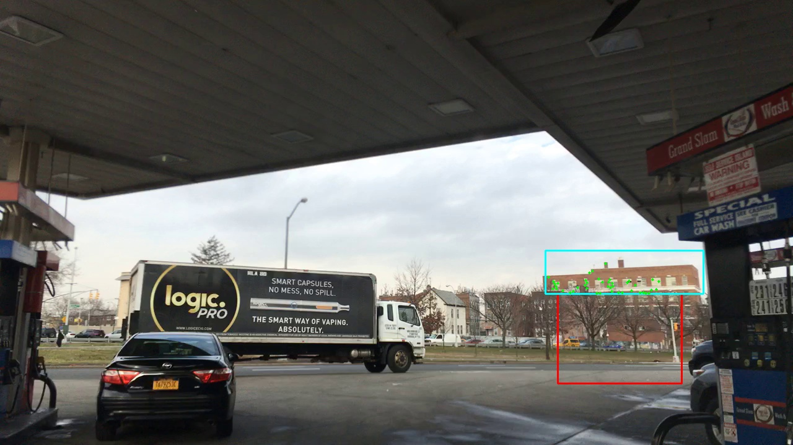

# Локальное движение здания не возвращает прежний номер

1. Получено

В фиксированной области здания880,405–1135,475 переход537→538 дал54 обучающих и57 контрольных точек, медиану ошибки0,135505 пикселя и90-й процентиль0,176911. Переход538→539 дал41 и43 точки, медиану0,376987 и90-й процентиль0,815777. Оба перехода прошли заранее заданную точность. Сдвиг здания538→539 равен−8,393066 по горизонтали и+11,723145 по вертикали. При прямой поправке стоимость232 становится0,801936,474 —0,760583; при остаточной —0,810526 и0,768014. При прежнем пороге0,8 рамку54471 получает474. В50 заранее заданных пробах погрешности (25 на каждый способ) победителем также остаётся474. Все308 исходных стоимостей и назначения воспроизведены точно; независимый скалярный пересчёт2156 стоимостей семи основных матриц совпал без погрешности. Источники research_local_background_probe_20261112/result.json, transforms/arms/sensitivity; research_local_background_probe_20261112/audit.json, competition.

2. Причинный предел

Более точная локальная оценка общего движения не восстановила232. Для этой фиксированной поправки подтверждён отрицательный результат: движение здания заметно, но его компенсации недостаточно для возвращения выбранного номера. Существующая474 имеет более выгодную геометрию и сохраняет рамку во всех50 проверенных возмущениях. Прежний удачный результат поправки только232 на основании неточной глобальной модели не доказывал достаточность компенсации. История рождения474 и отсутствие проверки активных трековFlyVis относятся к ранним событиям; позднее решение по карте не устраняет их автоматически.

Измерено движение изображения здания, не положение камеры в пространстве и не истинное движение машины. Равенство глубины здания и машины не доказано; возможны параллакс и собственное движение объекта.50 проб — зависимая сетка, не50 независимых наблюдений, не статистический доверительный интервал и не доказательство для всех непрерывных возмущений. На539 нет прямой эталонной метки личности. Глобальное преобразование всех прогнозов по движению одного здания — условная диагностическая подстановка; её правильность для всех глубин не утверждается. Порог0,8, веса и архив сохранены; полного трекера и нейронных вычислений нет. Не измереныHOTA, улучшение ядраFlyVis и точная причина неверного порядка нейронных оценок.

3. Как проверено

Область выбрана по ранее просмотренному изображению и записана до измерения локальных сдвигов. Она содержит фасад за целевой областью, исключает сам объект. Единственный вариант оценки — медианный сдвиг соответствий. Точки для оценки и проверки разделены пространственной сеткой20 пикселей. Условия: не менее20 точек каждой группы, контрольная медиана не выше1 пикселя,90-й процентиль не выше2. После результата область и условия не менялись. Это отдельный контроль гипотезы о разных глубинах сцены; прежний отказ глобальной проверки сохранён.

До подстановок проверено точное совпадение исходной матрицы22×14. Для основных и50 дополнительных назначений оптимальная сумма независимо сверена вторым решателем. Дополнительные пробы меняют только общий сдвиг по сетке5×5 в пределах±0,815777 пикселя по каждой оси; значения рабочих допусков не изменяются.

4. Решение

Не внедрять эту поправку как решение личности и не подбирать область или порог по возврату232. Закрыть проверенный локальный способ как не устраняющий отказ. Для объяснения общей цепочки учитывать отдельно рождение второго номера, первый разрыв назначения и позднюю оценку карт. Продолжать исследование собственноFlyVis на ошибках своих/чужих пар; результаты геометрии не подменяют объяснение активности ядра.

Литературное основание общего механизма: Aharon, Orfaig, Bobrovsky,2022, BoT-SORT, https://arxiv.org/abs/2206.14651. Статья обосновывает проверку компенсации движения камеры; она не устанавливает причины данного отказа.

Локальная компенсация → восстановление232 на539 →0 из2 основных общих поправок и0 из50 проб ошибки → приростHOTA и доля потолка не измерены.
