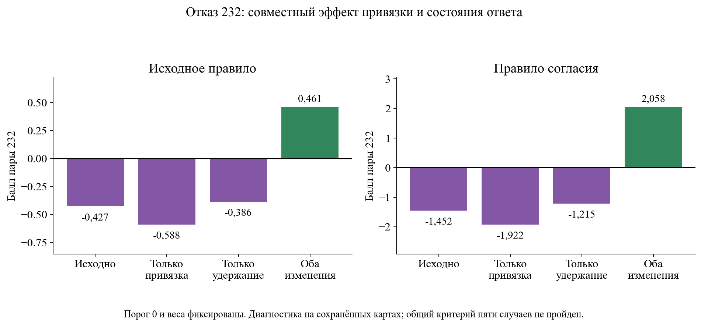

# Где возникает неверное различение своих и чужих

1. Подтверждённый результат

Проверены160наборов сравнения восьми ступеней на пяти случаях:2заранее сохранённые привязки и2области. Независимо пересчитаны320общих мер сходства, ошибка≤3,33e−16; прежние входные моменты и10векторовC34 воспроизведены. При исходной привязкеC34 полное согласие сырых цветных пикселей:232=0,12110,574=0,55250,832=−0,02360; подготовленного входа0,126821/0,666521/−0,000851; активностиC34 0,124839/0,555166/0,139426. Неверный порядок при исходной привязке уже наблюдается в пиксельном сравнении. Однако при второй сохранённой привязкеR134_temporal вход правильно ранжирует232 против574: разностьчужая−своя=−0,187949;C34 разворачивает её в+0,380178. Этот разворот сохраняется внутри рамки кандидата:−0,164811→+0,298041. Источники research_stage_localization_20261112/result.json, comparisons.json, audit.json.

Подтверждённая вычислительная зависимость: spatial_channel_features выбирает сдвиг максимума средней поканальной корреляции самих карт представления, tracking/channel_identity_head.py:14–52. Поэтому сравнение пикселей при сдвигеC34 не является независимой проверкой качества входа: выбранные координаты уже зависят отFlyVis. Для232 сдвиги различаются по вертикали на2,792839пикселя при одинаковой горизонтальной поправке. Вход поддерживает правильный порядок при другой сохранённой привязке; утверждать, что он безусловно потерял личность, нельзя.

2. Причинная проверка состояния ответа

На сохранённых контролируемых состояниях выполнен дополнительный разбор всех8прежних сочетаний удержания, всех5случаев,3представлений,2привязок и2областей:480общих оценок и960оценок двух замороженных правил. При второй привязке удержание только текущего конечного изображения1секунду меняет разностьчужая−своя232 с+0,380178 на−0,036414; удержание только образца оставляет+0,285764. Удержание обоих конечных изображений даёт−0,310488. Все конечные входы те же, веса и формула сравнения фиксированы; меняется момент считывания ответа. Это причинный эффект контролируемого времени ответа на данное ранжирование, не догадка по визуальной похожести. Источники research_stage_localization_20261112/terminal_addendum.json, terminal_results.json.

Для отказа своей пары232 установлено взаимодействие выбора сдвига и момента считывания. Исходное правило: исходные условия−0,426740; только другая привязка−0,588379; только удержание обоих при прежней привязке−0,385670; совместное изменение+0,461388. Правило согласия:−1,452065/−1,922244/−1,214943/+2,058389. Взаимодействие причинно меняет знак обоих фиксированных решений; ни один из этих двух одиночных контролей этого не делает. Это локализация конкретного отказа, не единственная возможная причина и не доказанный физически правильный сдвиг. Источник research_stage_localization_20261112/interaction_effects.json.

3. Что можно заключить

Ответ «только вход» или «только ядро» не соответствует данным. У исходной схемы есть зависимый отFlyVis выбор пространственного соответствия; при нём простое сходство разных объектов превышает сходство своего продолжения ещё на пиксельных выборках. Отдельно подтверждено, что при другой привязке непосредственный ответFlyVis разворачивает правильный входной порядок232; фиксированное удержание того же изображения снимает этот разворот. Для конкретного отказа232 подтверждено совместное действие пространственной привязки и переходного ответа. Для832 и остаточного ложного разрешения574 полного физического объяснения пока нет.

Принципиальное уточнение: фраза «ошибка уже во входе» без указания источника координат слишком сильна. В этом опыте сходство входа измерялось при замороженном сдвиге, который ранее выбрал самFlyVis. Поэтому нужно рассматривать полный путь: изображение → подготовленный вход → активность → выбор сдвига → сравнение → решающее правило. Другая привязка меняет входной порядок без изменения самого изображения.

На вторичных сравнениях сырые цветные пиксели правильно ранжируют232 в4из16комбинаций метрики/области/привязки/пары;C34 при немедленном считывании даёт неверный порядок во всех16. Это16зависимых диагностических сравнений, не16независимых сцен. Источникcomparisons.json. Для832 неверный порядок наблюдается при обеих сохранённых привязках; причина конкретного несоответствия физических деталей остаётся неизвестной.

Raw_gray_eye — отдельная диагностическая ветвь: сырая8битная яркость меняет размер и усредняется на сетке. Её изменение относительно подготовленного входа включает адаптацию и особенности численного представления при изменении размера, поэтому оно не приписывается одной адаптации. Основные выводы о сырых цветных пикселях и совместном эффекте сдвига/состояния от этой ветви не зависят.

4. Ограничения

Все новые разборы относятся к пяти давно известным случаям; дополнительная факторная проверка прямо отмечена как анализ после наблюдения разворота, а не независимый подтверждающий тест. Сырые выборки пикселей не равны всей информации полного изображения. Общая формула по разным каналам локализует измеренное сходство, но не измеряет всю различимость личности. Рамки не являются масками деталей объекта, физическая правильность привязок не установлена. Удержание1секунду — искусственный контроль с тем же конечным изображением, не доказательство равновесия и не реальное ожидание будущего кадра. Нейронное ядро заново не вызывалось; использованы прежние контролируемые состояния с проверенными входами и весами. Не установлена вина конкретного нейрона или связи. Нет новых весов, порогов, обучения, полного трекера иHOTA.

Дополнительный независимый оценщикcausal_audit.py заново проверил все960баллов через прямые ковариации и скалярные суммы: максимальная ошибка1,77636e−15. Он также побайтно сверил исходные истории с предыдущим опытом и проверил, чтоhistory_hold только добавляет30копий неизменного конечного входа. Источникcausal_audit.json.

5. Решение

Не внедрять совместный вариант: общий критерий пяти случаев не пройден. При второй привязке и удержании обоих чужая574 остаётся положительной:0,01994 у исходного правила,0,00547 у согласия; исходное правило дополнительно отвергает1102 со значением−0,02886,832 остаётся отвергнутой. Пороги не ослаблять и не поднимать ради этих чисел. Сохранить подтверждённую причину отказа232 как взаимодействие двух узлов; отдельно продолжить поиск физических причин остаточного сходства и условий надёжного соответствия. Основной нерешённый вопрос не сводить к точности входа или общей бесполезностиFlyVis.

Технически первый независимый оценщик остановился при синтаксическом разборе из-за пропуска пробела вусловном выраженииelse0. Расчёт измерений не повторялся; исправленныйaudit_v2.py пересчитал сохранённые данные. Ошибка и исходник сохранены вaudit_recovery.json иaudit.py.

Локализация → отказ своей пары232 при совместном диагностическом изменении → оба правила меняют отказ на принятие, но общего исправления5случаев нет → приростHOTA и доля потолка не измерены.
