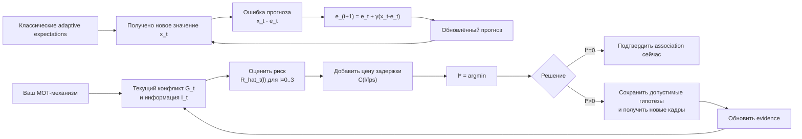

---
tags:
- документ
источник: dissertation/Адаптивные ожидания» в классической литературе и сопоставление с правилом адаптивного ожидания решения в многообъектном трекинге.md
---

↑ [[08 Документы/Диссертация/Диссертация|Диссертация]]

# «Адаптивные ожидания» в классической литературе и сопоставление с правилом адаптивного ожидания решения в многообъектном трекинге

## Исполнительное резюме

**Главный вывод:** классическое понятие *adaptive expectations* — «адаптивные ожидания» — и предложенное вами правило выбора, ждать ли ещё несколько кадров перед подтверждением идентичности, **не являются одним и тем же механизмом ни по математической форме, ни по смыслу**.

В классической экономической литературе adaptive expectations — это прежде всего **рекурсивное корректирование прогноза по последней ошибке прогноза**. Каноническая форма в современной записи:

\[
\hat x_{t+1|t}
=
\hat x_{t|t-1}
+
\gamma\left(x_t-\hat x_{t|t-1}\right),
\]

или, эквивалентно,

\[
\hat x_{t+1|t}
=
\gamma x_t+(1-\gamma)\hat x_{t|t-1}.
\]

Именно этот механизм связан с работами Филлипа Кагана, Марка Нерлова и ранней макроэкономикой ожиданий; он эквивалентен геометрически взвешенному среднему прошлых наблюдений. Нерлов в 1958 году посвятил отдельные разделы статье *Adaptive Expectations and Cobweb Phenomena* формулировке через adaptive expectations и эквивалентному представлению; Каган позднее вспоминал, что идея возникла из предложения А. У. Филлипса связывать изменение ожидаемого темпа с разностью фактического и ожидаемого темпов. citeturn16view1turn15view2

Ваше правило, напротив, имеет вид

\[
l_t^*
=
\arg\min_{l\in\{0,1,2,3\}}
\left[
\widehat{\mathcal R}_t(l)
+
C_{\rm delay}\!\left(\frac{l}{f}\right)
\right],
\]

где \(\widehat{\mathcal R}_t(l)\) — оценённый **сейчас** риск решения, которое будет принято после ещё \(l\) наблюдений. Оно выбирает не значение следующего прогноза, а **момент принятия решения**. В вашем описании дополнительно различаются \(q_{\rm det}\) и \(q_{\rm assoc}\), сохраняется несколько допустимых вариантов соответствия и разрешается обучать прогноз полезности ожидания на будущих кадрах, но при применении решение должно быть причинным и использовать только уже доступную информацию. fileciteturn0file0

Поэтому ближайшая классическая теория для вашего правила — **не adaptive expectations**, а сочетание **неблизорукого последовательного принятия решений (non-myopic sequential decision making), optimal stopping — оптимальной остановки, value of information — ценности дополнительной информации и ограниченного отложенного решения**. Monahan ещё в 1980 году формализовал оптимальную остановку в частично наблюдаемом процессе с платной дополнительной информацией: действие выбирается на основе текущего знания, а приобретение следующей информации оправдано её ожидаемой ценностью. citeturn18view0 Современная работа Achenchabe et al. строит почти тот же абстрактный компромисс: ожидаемая ошибка решения плюс стоимость задержки, причём неблизорукий алгоритм пытается заранее оценить ожидаемую будущую информационную выгоду от ожидания. citeturn17view0turn17view1

Отсюда следует важный вывод для диссертации: **называть ваш механизм реализацией классических «адаптивных ожиданий» нежелательно**. Это скорее создаёт риск терминологической и ложной новизны, чем укрепляет теоретическую основу. Термин лучше оставить для конкретного рекурсивного механизма типа exponential smoothing — экспоненциального сглаживания. Для вашего алгоритма точнее названия вроде **«адаптивное подтверждение идентичности на основе прогнозируемой ценности ожидания»**, **risk-aware adaptive decision delay** или **learned value-of-waiting policy for data association**.

Научная новизна потенциально возникает не из слов «адаптивный», «ожидание», «несколько гипотез» или «теория решений». MHT уже десятилетиями сохраняет конкурирующие гипотезы вместо немедленной фиксации соответствия; современная версия Kim et al. прямо описывает поддержание небольшого списка потенциальных гипотез. citeturn20search0 И сама идея балансировать ошибку против стоимости ожидания давно формализована за пределами трекинга. citeturn18view0turn17view0

**Потенциально защищаемое отличие** я вижу значительно уже: *причинная, обучаемая оценка ожидаемого уменьшения именно группового риска ошибочной ассоциации от получения ещё одного–трёх кадров и адаптивный выбор конечного лага для локальной конфликтной группы, при одинаковом ограничении задержки и без переобучения детектора*. Это уже операционально отличается и от постоянного коэффициента \(\gamma\) в adaptive expectations, и от простого фиксированного \(N\)-scan/фиксированной задержки. Но это следует формулировать как **потенциальную** новизну: проведённый поиск не доказывает, что эквивалентная адаптивная политика никогда не публиковалась.

Дата проверки литературы: **8 сентября 2026 года**.

## Классическое понятие и его математическая структура

### Откуда возник термин

В русскоязычной экономической терминологии закреплено выражение **«адаптивные ожидания»**, обычно во множественном числе. Большая российская энциклопедия определяет их через формирование ожиданий на основании наблюдавшихся прежде значений и записывает ожидаемую инфляцию как функцию прошлой инфляции. citeturn14search14 Это важно терминологически: выражение «адаптивное ожидание» в вашей постановке естественно читается как обычное русское словосочетание «адаптивно ждать», но в экономической теории *adaptive expectations* — уже занятый технический термин.

Исторически наиболее важны три связанные линии.

Первая — работа Phillip Cagan, *The Monetary Dynamics of Hyperinflation* в книге *Studies in the Quantity Theory of Money* 1956 года. Библиографическая запись подтверждает публикацию главы в сборнике под редакцией Милтона Фридмана. citeturn2search3 Позднее сам Каган подробно рассказал происхождение формулы. При исследовании гиперинфляций он искал модель ожидаемого изменения цен; Фридман обсуждал задачу с А. У. Филлипсом, который предложил, говоря словами Кагана, **“relating the change in the expected rate to the difference between the actual and expected rates”**. Каган затем преобразовал соответствующее дифференциальное уравнение в экспоненциально взвешенное среднее прошлых изменений цен. citeturn15view2

Вторая — Marc Nerlove, *Adaptive Expectations and Cobweb Phenomena*, *Quarterly Journal of Economics*, 1958. Это один из наиболее прямых классических первоисточников: сама структура статьи включает раздел *Reformulation in terms of adaptive expectations* и следующий раздел с «alternative but equivalent formulation». citeturn16view1 Нерлов встроил такое формирование ожиданий в динамическую модель предложения и «паутинообразной» динамики цен, а впоследствии подход широко применялся к реакции сельскохозяйственного предложения. Позднейшие методологические обзоры по supply response продолжают связывать этот класс моделей именно с Нерловом. citeturn5search0turn6search0

Третья — статистическая теория экспоненциально взвешенных прогнозов. Holt разработал forecasting by exponentially weighted moving averages в отчёте 1957 года; позднее этот материал был переиздан в *International Journal of Forecasting*. citeturn1search0turn1search13 В 1960 году John Muth в *Optimal Properties of Exponentially Weighted Forecasts* показал, что экспоненциально взвешенный прогноз не обязательно является лишь эвристикой: для определённого стохастического процесса он оказывается оптимальным прогнозом. citeturn0search3 Уже в 1961 году Muth предложил рациональные ожидания как существенно более информационно насыщенную альтернативу механическому backward-looking обновлению. citeturn16view3

### Каноническая формула

Удобная современная запись дана, например, в работе Junyi Liao 2026 года:

\[
\mathcal F_t w_{t+1}
=
\gamma w_t+
(1-\gamma)\mathcal F_{t-1}w_t,
\tag{AE}
\]

где \(\mathcal F_t w_{t+1}\) — прогноз следующего значения, \(w_t\) — только что наблюдённое фактическое значение, а \(\gamma\) — коэффициент корректировки, или gain. citeturn19search0turn19search4

То же самое можно записать как корректировку по ошибке:

\[
\mathcal F_t w_{t+1}
-
\mathcal F_{t-1}w_t
=
\gamma
\left[
w_t-\mathcal F_{t-1}w_t
\right].
\]

Содержательно правило говорит:

\[
\text{новое ожидание}
=
\text{старое ожидание}
+
\gamma\times\text{последняя ошибка}.
\]

Итерирование рекурсии даёт, после исчезновения влияния начального условия,

\[
\mathcal F_t w_{t+1}
=
\gamma w_t
+
\gamma(1-\gamma)w_{t-1}
+
\gamma(1-\gamma)^2w_{t-2}
+\ldots
\]

то есть

\[
\mathcal F_t w_{t+1}
=
\gamma
\sum_{j=0}^{\infty}
(1-\gamma)^j w_{t-j}.
\]

Таким образом, **адаптивные ожидания в классическом смысле — это геометрический distributed lag, распределённый лаг, или простое экспоненциальное сглаживание прошлых наблюдений**. Современная литература прямо описывает прогноз как взвешенную комбинацию текущей реализации и прошлого прогноза, в которой вся более старая история присутствует неявно через рекурсию. citeturn19search0 Федеральный резервный банк Ричмонда в историческом обзоре кривой Филлипса аналогично характеризует применявшиеся тогда адаптивные инфляционные ожидания как геометрически распределённый лаг прошлой фактической инфляции. citeturn16view6

Есть и непрерывная версия. В современной нейтральной нотации соответствующая идея выглядит как

\[
\frac{d e(t)}{dt}
=
\beta[x(t)-e(t)].
\]

Для постоянного \(x\) её решение экспоненциально приближает ожидание к фактическому значению. Именно переход от такого error-correction уравнения к экспоненциально взвешенному прошлому описывает Каган в ретроспективе. citeturn15view2

### Что означает «адаптивность»

Это очень важный пункт для сопоставления с вашей работой. В классической модели «adaptive» не означает «алгоритм самостоятельно решает, сколько ждать». Адаптивность заключается в том, что **численная оценка будущей переменной систематически корректируется после каждой новой ошибки прогноза**.

При стандартном \(0<\gamma<1\):

\[
e_{t+1}-\bar x
=
(1-\gamma)(e_t-\bar x)
\]

для постоянного уровня \(x_t=\bar x\). Поэтому ошибка уменьшается геометрически:

\[
|e_{t+n}-\bar x|
=
(1-\gamma)^n|e_t-\bar x|.
\]

В более общем математическом смысле рекурсия не расходится при

\[
0<\gamma<2,
\]

поскольку \(|1-\gamma|<1\); для \(1<\gamma<2\) знаки ошибки чередуются, то есть возникает переэкстраполяция. Liao прямо приводит диапазон \((0,2)\) как условие нерасходимости и отмечает, что обычный диапазон \((0,1)\) соответствует стандартной интерпретации взвешенного обновления. citeturn19search0

Половинное время устранения первоначальной ошибки при \(0<\gamma<1\) равно

\[
h_{1/2}
=
\frac{\ln(1/2)}{\ln(1-\gamma)}.
\]

Поэтому маленькое \(\gamma\) создаёт большую инерцию, а большое — быстрое реагирование. Цена быстроты состоит в большей чувствительности к шуму: современная интерпретация constant-gain learning прямо отмечает компромисс «higher gain → faster reaction, but more volatile estimates». citeturn19search1

Идеализированная реакция на единичный скачок хорошо показывает это свойство:

[Скачать график в PNG](sandbox:/mnt/data/adaptive_expectations_step_response.png)

Для построения использована аналитическая реакция

\[
e_n=1-(1-\gamma)^n,
\]

не эмпирические данные. Она непосредственно следует из классической рекурсии. Сам характер зависимости скорости реакции от \(\gamma\) соответствует формальному механизму adaptive expectations и современной его трактовке. citeturn19search0turn19search1

Следует различать **устойчивость самой рекурсии ожиданий** и устойчивость экономической системы, куда она встроена. В cobweb-модели Нерлова динамика цены дополнительно зависит от характеристик спроса и предложения; поэтому устойчивость всей системы не сводится к условию \(|1-\gamma|<1\). Уже структура оригинальной статьи Нерлова показывает, что adaptive expectations вводились именно как часть анализа cobweb dynamics, а не как изолированный фильтр. citeturn16view1

### Классические применения и ограничения

У Кагана ожидание темпа изменения цен входило в объяснение спроса на деньги во время гиперинфляции. citeturn15view2turn2search3 У Нерлова адаптивные ожидания использовались для динамики цен и предложения в cobweb-постановке. citeturn16view1 Позднее они широко вошли в макроэкономическое моделирование инфляционных ожиданий: исторический обзор Федерального резервного банка Ричмонда отмечает, что в эпоху ранней expectations-augmented Phillips curve ожидания инфляции задавались адаптивно и при постоянной инфляции постепенно сходились к её фактическому уровню. citeturn16view6

Классическое информационное предположение очень сильное: для простейшей формулы нужны лишь прошлый прогноз и новая реализация наблюдаемой переменной. Нет необходимости знать структурную модель среды, вероятности альтернативных будущих наблюдений или рассчитывать ожидаемую ценность будущей информации. citeturn19search0 Именно это одновременно делает механизм дешёвым и ограниченным.

Главный классический недостаток — backward-looking характер. Если структура процесса изменилась, простое adaptive-expectations правило узнает об изменении лишь через возникающие ошибки. Современная работа Liao прямо связывает историческую критику механизма с неспособностью простой backward-looking схемы адекватно учитывать изменение режима и с последовавшей революцией рациональных ожиданий. citeturn19search0turn19search4

Это, однако, не означает, что механизм всегда «нерационален». Muth ещё в 1960 году показал условия, при которых экспоненциальное взвешивание оптимально. citeturn0search3 Современные исследования уточняют этот результат: для определённых задач constant-gain update имеет байесовскую или state-space интерпретацию. citeturn19search1turn19search3

## Современные переинтерпретации и случаи фактического переименования

С историей названий следует быть особенно аккуратным. Не всё, что сегодня похоже на adaptive expectations, является просто новым названием старой формулы, и не всякое «adaptive learning» эквивалентно adaptive expectations.

| Современный термин | Связь с классическими adaptive expectations | Совпадение |
|---|---|---|
| **Simple exponential smoothing / EWMA**, простое экспоненциальное сглаживание | Та же рекурсия «новое = gain × наблюдение + (1−gain) × старое» для оценки уровня | Практически алгебраически полное в простейшем случае. Исторически это параллельная статистическая линия, а не обязательно сознательное переименование. citeturn1search0turn19search0 |
| **Constant-gain learning, CGL**, обучение с постоянным коэффициентом | При оценивании только среднего значения переменной CGL непосредственно реализует adaptive expectations | Полное совпадение в этом частном случае; не синоним для общего CGL. Berardi формулирует эту связь прямо. citeturn19search1 |
| **Adaptive learning**, адаптивное обучение экономических агентов | Коэффициенты некоторой forecasting model обновляются рекурсивно по данным | Более широкий класс. В моделях least squares обновляется вектор параметров модели, а не только одно ожидаемое значение. citeturn1search3turn1search12 |
| **Time-varying adaptive expectations**, адаптивные ожидания с переменным gain | \(\gamma_t\) вместо постоянного \(\gamma\) | Содержательное обобщение, а не новое имя. В работе 2012 года показано, что такой механизм минимизирует MSE для линейного state-space процесса и связан с Kalman filter. citeturn19search3 |
| **Kalman updating**, обновление Калмана | Формально напоминает error correction с коэффициентом усиления | Не синоним. В Kalman filter gain эндогенно следует из неопределённостей состояния/измерения; в простом AE \(\gamma\) задан экзогенно. citeturn19search0turn19search3 |
| **Noisy-information adaptive expectations** | Старое правило применено к индивидуально зашумлённым сигналам | Современное расширение. Liao 2026 показывает, что такая простая схема способна воспроизводить некоторые наблюдаемые under-/over-reaction patterns. citeturn19search0turn19search4 |
| **Rational expectations** | Альтернативный способ формирования ожиданий | Не переименование, а исторически конкурирующая концепция, использующая более богатое информационное предположение. citeturn16view3turn19search0 |
| **Optimal stopping / value of information** | Выбирается, стоит ли собирать дополнительную информацию или остановиться | Математически другой класс задач. Именно он гораздо ближе к вашему правилу. citeturn18view0 |
| **Non-myopic early decision** | Предсказывается будущая информационная выгода и балансируется против delay cost | Почти тот же абстрактный decision functional, что в вашем предложении, но иной объект решения. citeturn17view0 |

Особенно показателен случай **constant-gain learning**. Berardi пишет, что алгоритм constant gain для оценки среднего фактически реализует adaptive expectations, а увеличение gain означает более быстрое реагирование ценой более волатильных оценок. citeturn19search1 Здесь действительно можно говорить почти о том же старом механизме под языком современной learning literature.

Но уже при оценивании коэффициентов структурной forecasting model CGL значительно шире. Liao специально подчёркивает, что многие работы по constant-gain learning заставляют агентов обновлять коэффициенты эконометрической модели, что отличается от простого benchmark adaptive expectations. citeturn19search2 Поэтому утверждение «constant-gain learning — новое название adaptive expectations» было бы верно только для специального случая.

Ещё более сильный пример обобщения — статья *When are adaptive expectations rational? A generalization*. В ней \(\gamma\) разрешается меняться во времени, и авторы показывают связь с оптимальным MSE-прогнозированием в линейной state-space модели; прежние результаты оказываются частными случаями свойства фильтра Калмана. citeturn19search3 Это важно для оценки новизны: **просто заменить константу \(\gamma\) на контекстно зависящий \(\gamma_t\) сегодня недостаточно, чтобы претендовать на фундаментально новый механизм adaptive expectations**.

Исторически попытки сделать скорость адаптации переменной появились тоже давно. Khan в 1977 году критиковал предположение о постоянной скорости пересмотра ожиданий в гиперинфляции и исследовал изменяющуюся интенсивность адаптации. citeturn1search8 Поэтому правило вида

\[
e_{t+1}
=
e_t+\gamma(z_t)(x_t-e_t),
\]

где \(\gamma\) зависит от «уверенности», величины шока, уровня инфляции или состояния сцены, само по себе обычно является **variable-gain adaptive expectation**, а не новым принципом.

Современная литература не только отказалась от старого механизма. Работа Liao, опубликованная в *Economica* и вышедшая в актуальной журнальной версии к 2026 году, вновь анализирует adaptive expectations с noisy signals и показывает, что механизм может генерировать under-reaction, extrapolation и delayed overshooting при определённых отношениях persistence и gain. citeturn19search0turn19search4 Поэтому корректнее говорить не «устаревшая забытая идея», а **старый, очень хорошо известный базовый механизм, который продолжает получать новые вероятностные и поведенческие интерпретации**.

## Сопоставление с предложенным правилом принятия решения

Ваше описание достаточно конкретно, чтобы **не ставить всю колонку «неуточнено»**. Указаны множество допустимых горизонтов \(l\in\{0,1,2,3\}\), ожидаемый ущерб решения после ожидания, цена задержки, причинное ограничение при применении, локальные конфликтующие группы и смысл \(q_{\rm assoc}\). Неуточнёнными остаются именно модель \(\widehat{\mathcal R}_t(l)\), численная функция ущерба, способ калибровки \(q_{\rm assoc}\) и правила окончательной фиксации/пересмотра ID. fileciteturn0file0

### Формальная реконструкция вашего правила

Обозначим через

\[
\mathcal I_t
\]

всю информацию, доступную в момент \(t\);

\[
G_t
\]

локальную конфликтную группу треков и детекций;

\[
\mathcal A(G_t)
\]

конечное множество допустимых соответствий;

\[
H^\star
\]

истинное соответствие;

\[
Y_{t+1:t+l}
\]

ещё не наблюдавшиеся данные следующих \(l\) кадров.

Тогда содержательно строгая версия вашей идеи может быть записана как **предварительный ожидаемый байесовский риск после получения дополнительной информации**:

\[
R_t(l)
=
\mathbb E_{Y_{t+1:t+l}\mid\mathcal I_t}
\left[
\min_{a\in\mathcal A(G_t)}
\mathbb E
\left[
L(a,H^\star)
\mid
\mathcal I_t,Y_{t+1:t+l}
\right]
\right].
\tag{1}
\]

После этого

\[
l_t^\star
=
\arg\min_{l\in\{0,1,2,3\}}
\left\{
R_t(l)
+
\lambda_\tau\frac{l}{f_t}
\right\}.
\tag{2}
\]

Эта формулировка уточняет критически важную вещь: во время применения алгоритм **не смотрит на будущие \(Y\)**. Он интегрирует по их прогнозируемому распределению или непосредственно предсказывает ожидаемый будущий риск на основании \(\mathcal I_t\). Это классическая логика preposterior analysis/value of information и optimal stopping: дополнительная информация ещё не известна, но её ожидаемая ценность может быть оценена на основании текущего состояния знания. citeturn18view0

В машинном обучении почти точная абстрактная конструкция присутствует у Achenchabe et al.: критерий одновременно содержит стоимость неправильной классификации и задержки, а неблизорукий алгоритм пытается **предвидеть ожидаемое будущее увеличение информации и сопоставить его со стоимостью ожидания**. citeturn17view0turn17view2 Разница с вашей задачей принципиальна по предмету: там определяется момент классификации одной временной последовательности, а у вас необходимо сохранить глобально допустимое соответствие множества конкурирующих track–detection assignments и идентичности объектов.

Удобно также определить **ценность ожидания**:

\[
\operatorname{VoW}_t(l)
=
R_t(0)-R_t(l).
\]

Тогда ожидание оправдано тогда и только тогда, когда прогнозируемое уменьшение риска достаточно велико относительно цены задержки:

\[
\operatorname{VoW}_t(l)
>
\lambda_\tau \frac{l}{f_t},
\]

с учётом того, что сравниваться должны все допустимые \(l\), а не только \(0\) против \(1\).

Именно \(\operatorname{VoW}\), а не «адаптивное ожидание» в экономическом смысле, я бы сделал центральной теоретической величиной вашей постановки.

### Сравнение по требуемым критериям

| Критерий | Классические adaptive expectations | Ваше правило |
|---|---|---|
| **Что является объектом решения** | Численное ожидание/прогноз \(e_{t+1}\) некоторой переменной. citeturn19search0 | Момент фиксации ID/association: \(l_t^\star\in\{0,1,2,3\}\), плюс последующий выбор соответствия. fileciteturn0file0 |
| **Формула обновления** | \(e_{t+1}=e_t+\gamma(x_t-e_t)\). Новая реализация корректирует старый прогноз. citeturn19search0 | Не задано рекурсивное обновление ожидания. Задан minimization: \(\arg\min_l[\widehat R_t(l)+C_{\rm delay}(l/f)]\). **Модель \(\widehat R_t(l)\) пока частично неуточнена.** fileciteturn0file0 |
| **Что означает адаптивность** | Ожидание адаптируется по величине последней ошибки; интенсивность задаётся \(\gamma\). citeturn19search0 | Длительность задержки адаптируется к конкретной неоднозначной ситуации. Это другой смысл слова adaptive. |
| **Устойчивость** | Для изолированной линейной рекурсии ошибка умножается на \(1-\gamma\); нерасходимость при \(0<\gamma<2\), стандартное монотонное сглаживание при \(0<\gamma\le1\). citeturn19search0 | Аналогичной линейной устойчивости нет. Необходимо определить стабильность как отсутствие бесконечного откладывания, непротиворечивость групповых ID и поведение при повторной переоценке. Максимум \(l=3\) гарантирует конечную задержку, но **правило пересмотра уже выданных ID неуточнено**. fileciteturn0file0 |
| **Реакция на шок** | Скорость полностью контролируется gain: высокий \(\gamma\) быстро переносит новый факт в прогноз, низкий создаёт инерцию. citeturn19search1turn19search0 | При информативном изменении сцены хороший predictor может выбрать \(l=0\); при неразрешённой окклюзии — \(l>0\). Но ожидание не гарантирует получение информации. Это исследовательская гипотеза, а не свойство формулы. |
| **Скорость сходимости** | Геометрическая: фактор \(|1-\gamma|\); для постоянного уровня имеется явное half-life. | Ассимптотическая сходимость — не естественная характеристика. Имеются конечные **decision latency**, вероятность корректного association после \(l\) и уменьшение риска \(R_t(0)-R_t(l)\). |
| **Требуемая информация** | Текущая/прошлая реализация и предыдущее ожидание; структурная модель обычно не требуется. citeturn19search0turn19search1 | История движения/рамок, конкуренция соответствий, пропуски, окклюзия, confidence и др.; полный набор пока предлагается как кандидаты. Будущие кадры допустимы для обучения, но не для inference. fileciteturn0file0 |
| **Использование конкурирующих гипотез** | Не является частью канонической формулы. | Да: несколько association hypotheses внутри локального конфликта. Но сама эта идея известна из MHT. citeturn20search0 |
| **Будущая информация при текущем решении** | Нет модели возможных будущих сигналов: ожидание просто обновится, когда наблюдение придёт. citeturn19search0 | Центральный объект — ожидаемая полезность ещё не полученного наблюдения; inference остаётся причинным. По структуре это ближе к value of information. citeturn18view0 |
| **Типичный эмпирический прогноз** | Геометрически убывающий вес прошлого; инерционность после изменения режима; trade-off responsiveness/noise. citeturn19search0turn19search1 | Предположение: выигрыш ассоциации должен концентрироваться в случаях, где следующий кадр реально уменьшает неоднозначность; в остальных случаях должен выбираться малый lag. Это ещё требует проверки. |
| **Основной параметр** | \(\gamma\), постоянный или в расширениях \(\gamma_t\). | Delay cost \(\lambda_\tau\), максимальный lag \(L\), параметры predictor \(R_t(l)\), возможно weights association loss. Последние **частично неуточнены**. |
| **Естественный baseline** | Static expectations, exponential smoothing с различным gain, rational/Kalman updating. citeturn19search3turn19search0 | \(l=0\); фиксированный \(l=1,2,3\); фиксированный \(N\)-scan/отложенное association; адаптивная политика с тем же генератором гипотез. |

Особенно важна строка «реакция на шок». В classical AE **наблюдение уже произошло**, после чего прогноз корректируется. В вашем алгоритме ключевой вопрос возникает **до наблюдения**:

> Стоит ли платить задержкой за возможность получить ещё одно наблюдение?

Это принципиально другой временной порядок.

### Схема различия механизмов

Общая черта здесь действительно есть: оба метода используют прошлую информацию для поведения в будущем. Но эта черта слишком общая, чтобы считать механизмы одной теорией.

### Что будет, если всё-таки встроить adaptive expectations в ваш трекер

Классический механизм можно совершенно буквально применить, например, к сглаживанию \(q_{\rm assoc}\):

\[
\bar q_{{\rm assoc},t}
=
(1-\gamma)\bar q_{{\rm assoc},t-1}
+
\gamma q_{{\rm assoc},t}.
\]

Или к скалярному conflict score:

\[
\bar r_t
=
\bar r_{t-1}
+
\gamma(r_t-\bar r_{t-1}).
\]

Тогда действительно можно утверждать, что **конкретная вспомогательная величина обновляется по adaptive-expectations/EWMA rule**. Но само по себе это не будет научной новизной: такая рекурсия является классической, а variable gain тоже давно рассмотрен в литературе. citeturn19search1turn19search3

Такое сглаживание я бы допускал как baseline или feature engineering, но **не как центральный вклад диссертации**.

## Где проходит граница новизны

### Что почти наверняка является переименованием

Первый случай — назвать

\[
z_{t+1}
=
(1-\gamma)z_t+\gamma x_t
\]

«новой схемой адаптивного накопления доверия». Это по существу EWMA/adaptive expectations. Историческая и современная литература давно содержит ровно такую структуру. citeturn15view2turn19search0turn19search1

Второй случай — сделать \(\gamma\) функцией текущей уверенности или величины шока и объявить «динамическое адаптивное ожидание». Переменные параметры адаптации исследовались как минимум в работах о variable adjustment speed, а общая time-varying adaptive-expectations схема связана с Kalman filtering и оптимальным MSE updating. citeturn1search8turn19search3 Это может быть полезной инженерной модификацией, но новизну надо искать в конкретной модели gain, теореме или эмпирически новом эффекте.

Третий случай — «при неоднозначности не фиксируем соответствие сразу, а сохраняем несколько гипотез». Это классическая логика MHT. Kim et al. в ICCV 2015 прямо возвращаются к MHT в tracking-by-detection и подчёркивают поддержание небольшого списка потенциальных hypotheses. citeturn20search0 Следовательно, даже сочетание современного детектора с сохранением нескольких ветвей не является новым принципом.

Четвёртый случай — «будем ждать, пока уверенность станет достаточно высокой». В широком смысле это относится к sequential decision/reject-option/early-decision литературе; уже Achenchabe et al. явно оптимизируют ошибку вместе со стоимостью задержки и заранее оценивают будущий информационный выигрыш. citeturn17view0

Пятый случай — «останавливаем сбор информации, когда ожидаемая польза следующего наблюдения меньше его стоимости». Это классическая value-of-information/optimal-stopping структура. Monahan формализовал именно решение о приобретении дополнительной информации в частично наблюдаемом процессе на основании текущего информационного состояния. citeturn18view0

### Что может быть содержательно новым

Потенциально интересное отличие должно располагаться **внутри конкретной MOT-задачи**, а не на уровне общей теории решения.

Наиболее защищаемая формулировка выглядит так:

> **Для локальной группы конкурирующих траекторий предлагается причинный предиктор ожидаемого уменьшения группового риска неверной идентификации при получении ещё \(l\) кадров; на его основе динамически выбирается lag \(l\in\{0,\ldots,L\}\), после которого association становится окончательным, при явной стоимости задержки и ограниченном числе поддерживаемых гипотез.**

Почему это сильнее.

MHT уже даёт альтернативные hypotheses, поэтому вы не присваиваете себе MHT. citeturn20search0

Optimal stopping уже даёт принцип «решать или собирать информацию», поэтому вы не присваиваете себе теорию остановки. citeturn18view0

Achenchabe уже даёт неблизорукое prediction-of-future-information-gain, поэтому вы не называете общей новизной expected loss + delay cost. citeturn17view0

Ваш возможный вклад находится в конкретном **state representation, target quantity и group-consistent decision rule для MOT**.

Особенно сильным отличием может стать не

\[
P(\text{текущая ассоциация правильна}),
\]

а

\[
\mathbb E[
R_t(0)-R_t(l)
\mid\mathcal I_t
],
\]

то есть **прогнозируемое уменьшение риска благодаря ожиданию**. Высокая текущая неопределённость и высокая полезность ожидания — не одно и то же.

Например, две траектории могут быть крайне неоднозначны сейчас, но двигаться параллельно с почти одинаковыми внешними признаками. Тогда

\[
R_t(0)\ \text{велик},
\qquad
R_t(0)-R_t(1)\approx0,
\]

и ждать бессмысленно.

Напротив, при кратковременном пересечении с различными скоростями

\[
R_t(0)\ \text{велик},
\qquad
R_t(0)-R_t(1)>0,
\]

потому что разведение объектов после crossing предсказуемо даст информативную геометрию.

Вот это различение **uncertainty now** против **expected resolvability by waiting** является содержательно сильнее обычной confidence thresholding. Общий теоретический принцип ценности информации известен, но его конкретная операционализация для конфликтной MOT-группы может составить собственный метод. Это вывод из сопоставления, а не утверждение о доказанной мировой новизне. citeturn18view0turn17view0

### Почему фиксированный MHT/N-scan — опасный ближайший baseline

Классический MHT уже отсрочивает окончательное разрешение неоднозначных associations за счёт разветвления hypotheses; современная компьютерно-зрительная версия показывает, что даже классическая реализация MHT может быть сильным tracking-by-detection методом. citeturn20search0 Поэтому утверждение диссертации должно быть не

> «мы откладываем решение на несколько кадров»,

а

> «мы **предсказываем для каждого локального конфликта**, приносит ли дополнительный кадр ожидаемое уменьшение assignment risk, и поэтому используем переменную, а не фиксированную глубину задержки».

Таргет должен быть именно **ценностью дополнительного observation**, а не просто индикатором «сейчас uncertain».

Проведённый целевой поиск по adaptive N-scan/adaptive decision delay не дал мне первичного источника, который по доступному описанию полностью совпал бы с этой конкретной комбинацией для image-based MOT. Однако такой отрицательный результат **не позволяет утверждать, что комбинация никем не была реализована**. Более того, существует большая литература по MHT, adaptive pruning, delayed association и radar tracking; даже современные radar-работы используют delayed multi-hypothesis decision strategies. Например, опубликованная в 2026 году работа IMM-TrackletMHT прямо описывает delayed decision-making на основе multiple hypotheses, хотя её механизм по доступному тексту не является вашим прогнозируемым variable-lag value-of-waiting rule. citeturn13search8

Поэтому уровень уверенности в формулировке новизны должен быть:

**подтверждено источниками:** constituent ideas известны;

**вывод из сопоставления:** ваш current decision functional не является adaptive expectations;

**исследовательская гипотеза:** обучаемый group-level predictor of value-of-waiting с переменной конечной задержкой может оказаться защищаемым собственным вкладом.

## Рекомендации по формулировке метода и экспериментальной проверке

### Как я бы назвал правило

На русском наиболее чистая формулировка:

**«Адаптивное подтверждение идентичности на основе прогнозируемой ценности ожидания»**.

Или более технически:

**«Адаптивный выбор задержки ассоциации по прогнозируемому уменьшению риска идентификации»**.

Английский вариант для статьи:

**Risk-Aware Adaptive Identity Confirmation via Learned Value of Waiting**

или

**Learned Adaptive Decision Delay for Ambiguous Multi-Object Association**.

Термин **adaptive expectations** лучше вообще не помещать в название метода. В related work можно один раз пояснить:

> В отличие от классической модели adaptive expectations, где численный прогноз рекурсивно корректируется по прошлой ошибке, предлагаемый механизм адаптирует не прогнозируемое значение, а момент фиксации association на основе ожидаемой ценности ещё не полученного наблюдения.

Это утверждение непосредственно следует из формального различия между классической рекурсией и последовательным stopping rule. citeturn19search0turn18view0

### Что именно следует считать состоянием

Я бы не начинал с длинного набора признаков. Из вашего списка минимально научно необходимы те признаки, которые отвечают на два разных вопроса.

Первый:

\[
\text{Насколько решение неоднозначно сейчас?}
\]

Для него нужны relative association costs/probabilities: разница между лучшим и вторым вариантом, взаимная конкуренция, entropy или margin между допустимыми assignments.

Второй:

\[
\text{Есть ли основания ожидать, что неоднозначность скоро разрешится?}
\]

Для него нужны динамические признаки: относительная скорость, относительное положение, тренд IoU/перекрытия, длительность текущего overlap/miss и изменения геометрии.

Detector confidence стоит использовать осторожно. Ваше исходное различие \(q_{\rm det}\) и \(q_{\rm assoc}\) логично: высокая вероятность существования объекта не означает однозначность его identity assignment. fileciteturn0file0 Поэтому detector confidence имеет смысл как вспомогательный показатель качества observation, но не как основной surrogate для association risk.

Appearance можно включить, если он уже дешёво доступен в базовом трекере, но для первого научного прототипа он не обязателен. Иначе трудно будет понять, улучшилось ли решение благодаря value-of-waiting или просто благодаря ещё одному appearance cue.

### Как определить обучающую цель

Я рекомендую не обучать

\[
\hat l_t
\]

на «идеальный lag» напрямую как четырёхклассовую classification target. Более интерпретируемая постановка — предсказывать ожидаемый terminal association loss:

\[
\widehat R_t(0),
\widehat R_t(1),
\widehat R_t(2),
\widehat R_t(3).
\]

Ground truth при обучении разрешает посмотреть в будущее и вычислить, какой минимальный association loss фактически стал достижим после \(l\) кадров. При inference predictor получает лишь \(\mathcal I_t\). Это точно соответствует вашему ограничению и отделяет **supervision from future** от **future leakage at deployment**. fileciteturn0file0

Ещё лучше с точки зрения интерпретации обучать marginal value:

\[
\Delta_t(l)
=
R_t(l-1)-R_t(l),
\]

то есть «сколько ожидаемого association risk снимает именно следующий дополнительный кадр».

Тогда decision rule становится понятным:

\[
\text{продолжить ожидание, если }
\widehat{\Delta}_t(l)
>
\text{marginal delay cost}.
\]

Это уже очень близко к классической value-of-information логике: дополнительное наблюдение покупается только тогда, когда его ожидаемая ценность превышает стоимость. citeturn18view0

### Каким должен быть loss

Нельзя использовать только «правильна ли выбранная пара track–detection». При конфликте решения взаимозависимы: присвоение одной детекции треку меняет допустимость остальных associations.

Поэтому единицей решения лучше считать всю локальную группу \(G_t\), а

\[
L(a,H^\star)
\]

делать group-level loss.

Минимальная разумная версия может штрафовать неверную перестановку ID и потерю правильного продолжения трека. Вес пропуска должен быть ненулевым, чтобы алгоритм не «улучшал» association metric, постоянно отказываясь подтверждать неудобные объекты. Это прямо соответствует ограничению, сформулированному в вашем проектном описании. fileciteturn0file0

При этом не обязательно превращать сам training loss в HOTA: достаточно association-oriented surrogate, а окончательную полезность проверять HOTA/AssA/IDF1 и отдельно DetA на всей системе.

### Минимальный эксперимент, который действительно проверяет гипотезу

Ключевой эксперимент должен различать **ценность адаптивности лага** и ценность самого delayed association.

Сравнение:

| Вариант | Генератор конфликтов/гипотез | Максимум будущих кадров | Как выбирается lag |
|---|---:|---:|---|
| Исходный tracker | одинаковый | 0 | немедленное решение |
| Fixed-delay | одинаковый | \(L\) | всегда фиксированное \(l\), например 1 или 2 |
| **Adaptive value-of-waiting** | одинаковый | тот же \(L\) | правило \(\arg\min_l[\widehat R_t(l)+C_{\rm delay}]\) |

Именно одинаковый механизм построения alternatives критичен: иначе нельзя будет установить, что эффект принадлежит adaptive waiting, а не более сильному hypothesis generation.

Дополнительно полезен один контроль:

\[
\text{uncertainty-only policy}
\]

— ждать при низком текущем association margin, но **не предсказывать полезность будущего кадра**. Это отделяет ваш предполагаемый вклад «предсказывать resolvability» от тривиального «при неуверенности жди».

Такой контроль особенно важен теоретически, поскольку высокая неопределённость не гарантирует положительной ценности дальнейшего наблюдения. Именно эта разница является наиболее содержательной частью предлагаемой гипотезы.

Успех должен оцениваться не как «получили больше AssA любой ценой», а как trade-off:

\[
(\text{HOTA},\text{AssA},\text{IDF1},\text{DetA},
\text{mean delay},\text{max delay}).
\]

Для фиксированного и adaptive варианта нужен одинаковый максимальный delay budget, а желательно сравнение и при сопоставимом **среднем** delay budget. Иначе adaptive policy может выиграть просто за счёт того, что фактически использует больше будущих кадров.

**Опровергающий результат** следует определить заранее:

> Если при одинаковом механизме hypotheses и одинаковом latency budget adaptive value-of-waiting не превосходит фиксированную задержку по association metrics либо выигрыш исчезает после учёта DetA/пропущенных объектов, то гипотеза о полезности контекстного прогноза момента ожидания не подтверждается.

Ещё более сильное опровержение:

> Если uncertainty-only heuristic не хуже обученного value-of-waiting predictor, то будущая «разрешимость» фактически не была выучена; усложнение не даёт установленного собственного эффекта.

Такой отрицательный результат научно осмыслен и не требует заранее обещать прирост.

### Что реально отличит диссертационный вклад

Я бы сформулировал заявляемый вклад примерно так:

> **Предложен метод ограниченно-задержанного подтверждения идентичности в online MOT, который для локальных конфликтных групп оценивает не только текущий риск association, но и причинно прогнозируемое уменьшение этого риска от получения дополнительных наблюдений. На основании этой оценки совместно выбирается длительность задержки \(l\le L\) и момент окончательной фиксации соответствий при явной стоимости latency.**

После этого сразу требуется оговорка:

> Сохранение нескольких hypotheses, delayed commitment и общий принцип «ошибка плюс стоимость задержки» сами по себе не заявляются как новизна, поскольку они имеют классические аналоги в MHT, optimal stopping и non-myopic early decision. citeturn20search0turn18view0turn17view0

Такое самоограничение, на мой взгляд, **усиливает**, а не ослабляет новизну: рецензенту заранее показано, что вы знаете ближайшие общие механизмы и заявляете только операционально отличающийся компонент.

## Итоговая оценка и ключевые источники

**Вердикт по понятию «адаптивное ожидание»:** использовать классические *adaptive expectations* как название или прямую теоретическую идентификацию вашего правила **не следует**. Классическая теория формализует backward-looking error-correction update прогноза; ваше правило является forward-looking в decision-theoretic смысле: из текущего состояния оно оценивает ожидаемую полезность ещё не наблюдавшейся информации и выбирает время решения. citeturn19search0turn18view0

**Вердикт по сходству:** общим является только очень широкий мотив «использовать накопленную информацию, чтобы адаптировать последующее поведение». Математически этого недостаточно для отнесения двух правил к одному механизму.

**Вердикт по ближайшей теоретической традиции:** наиболее точная классификация вашего \(l^\star\) — **finite-horizon non-myopic sequential decision / approximate optimal stopping under costly information**, дополненная MHT-подобным представлением association hypotheses. Monahan задаёт классический каркас costly information/optimal stopping; Achenchabe et al. дают особенно близкую современную форму «future information gain versus waiting cost»; MHT задаёт исторический каркас сохранения competing association hypotheses. citeturn18view0turn17view0turn20search0

**Вердикт по возможной научной новизне:** она не содержится ни в adaptive expectations, ни в ожидании как таковом, ни в поддержании нескольких hypotheses. Наиболее перспективное узкое отличие — **learned causal value-of-waiting for a jointly constrained local association group**, то есть обучение не «уверенности в текущем ID», а ожидаемого **изменения** group-level association risk при ожидании ещё \(l\) кадров. По результатам проведённого поиска точного совпадения этой полной конструкции в рассмотренных первичных источниках не установлено, но это нельзя интерпретировать как доказательство её глобальной новизны.

Ключевой классический корпус литературы выглядит следующим образом.

| Источник | Роль для вашего обзора |
|---|---|
| **Cagan, P. (1956), “The Monetary Dynamics of Hyperinflation”, Studies in the Quantity Theory of Money** | Раннее классическое применение error-correction expectations к ожидаемой динамике цен; происхождение механизма позднее объяснено самим Каганом. citeturn2search3turn15view2 |
| **Nerlove, M. (1958), “Adaptive Expectations and Cobweb Phenomena”, QJE 72(2), 227–240** | Каноническая статья, прямо посвящённая adaptive expectations, их эквивалентной формулировке и cobweb dynamics. citeturn16view1 |
| **Holt, C. C. (1957; reprint 2004), “Forecasting Seasonals and Trends by Exponentially Weighted Moving Averages”** | Параллельная forecasting-традиция экспоненциального сглаживания, математически тесно связанная с рекурсией AE. citeturn1search0turn1search13 |
| **Muth, J. F. (1960), “Optimal Properties of Exponentially Weighted Forecasts”, JASA 55** | Показывает условия, при которых экспоненциально взвешенный прогноз оптимален. citeturn0search3 |
| **Muth, J. F. (1961), “Rational Expectations and the Theory of Price Movements”, Econometrica 29(3)** | Главная историческая альтернатива механическим backward-looking expectations. citeturn16view3 |
| **Khan, M. S. (1977), “The Variability of Expectations in Hyperinflations”, JPE** | Ранний пример отказа от постоянной скорости адаптации; важен против заявки «мы впервые сделали gain адаптивным». citeturn1search8 |
| **Evans & Honkapohja (2001), Learning and Expectations in Macroeconomics** | Авторитетная монография по более широкому adaptive-learning направлению. citeturn1search12 |
| **Berardi (2020), “A Probabilistic Interpretation of the Constant Gain Learning Algorithm”** | Показывает точную связь constant-gain mean learning с adaptive expectations и trade-off скорости/волатильности. citeturn19search1 |
| **“When are adaptive expectations rational? A generalization” (2012), Economics Letters 115(1)** | Time-varying gain и связь adaptive expectations с Kalman filter/state-space optimal forecasting. citeturn19search3 |
| **Liao (2026), “Adaptive expectations and reaction to information”, Economica** | Современная формальная реконструкция канонической формулы, noisy-signal extension и эмпирическая переоценка старого механизма. citeturn19search0turn19search4 |
| **Monahan (1980), “Optimal Stopping in a Partially Observable Markov Process with Costly Information”, Operations Research** | Наиболее подходящая классическая decision-theoretic основа вашего «ждать или решать». citeturn18view0 |
| **Achenchabe et al. (2021), “Early Classification of Time Series: Cost-based Optimization Criterion and Algorithms”, Machine Learning** | Особенно близкий абстрактный аналог: expected future information gain против waiting cost. citeturn17view0 |
| **Kim et al. (2015), “Multiple Hypothesis Tracking Revisited”, ICCV** | Опасный для чрезмерной заявки MOT-аналог: сохранение нескольких конкурирующих association hypotheses уже является классической частью MHT. citeturn20search0 |

Русскоязычный обзорный термин можно привязать к актуальной статье БРЭ об инфляционных ожиданиях, где adaptive expectations определяются через прошлую наблюдаемую инфляцию. citeturn14search14 Однако для математического и исторического обоснования предпочтительнее цитировать оригинальные англоязычные работы: само понятие сформировалось именно в этой литературе, а русский источник в данном случае является обзорным, а не первичным.

**Рекомендуемое решение для вашей работы:** не пытаться обосновывать метод через «новое понимание adaptive expectations». Теоретически сильнее поставить его как **ограниченно-задержанное последовательное решение с обучаемой оценкой value of waiting**, а классические adaptive expectations упомянуть только для снятия терминологической неоднозначности. Центральная формула диссертации тогда должна описывать не сглаживание \(q_{\rm assoc}\), а прогнозируемый Bayes/group association risk \(R_t(l)\) и его уменьшение \(\operatorname{VoW}_t(l)\). Такое разграничение одновременно точнее классической литературы, честнее в отношении предшествующих работ и оставляет гораздо более ясное пространство для собственного проверяемого вклада.